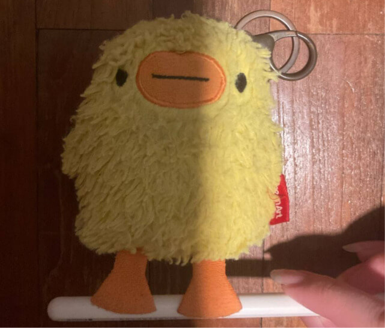
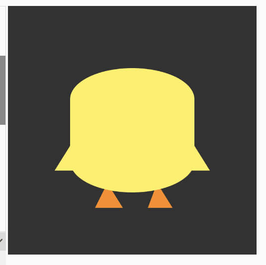
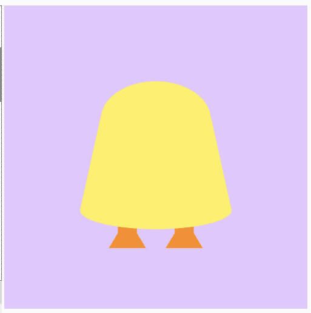
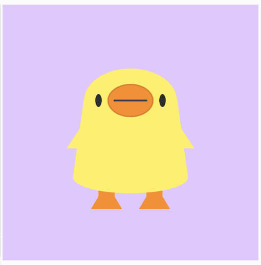
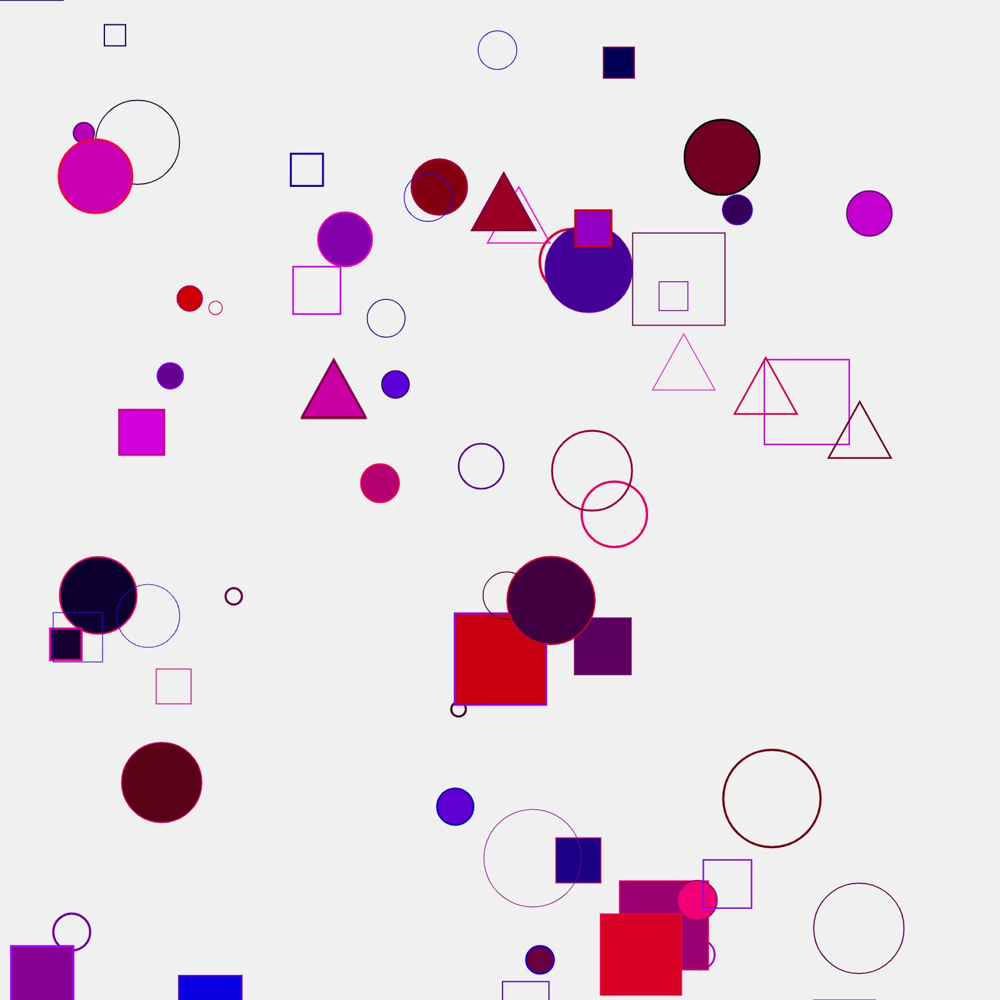
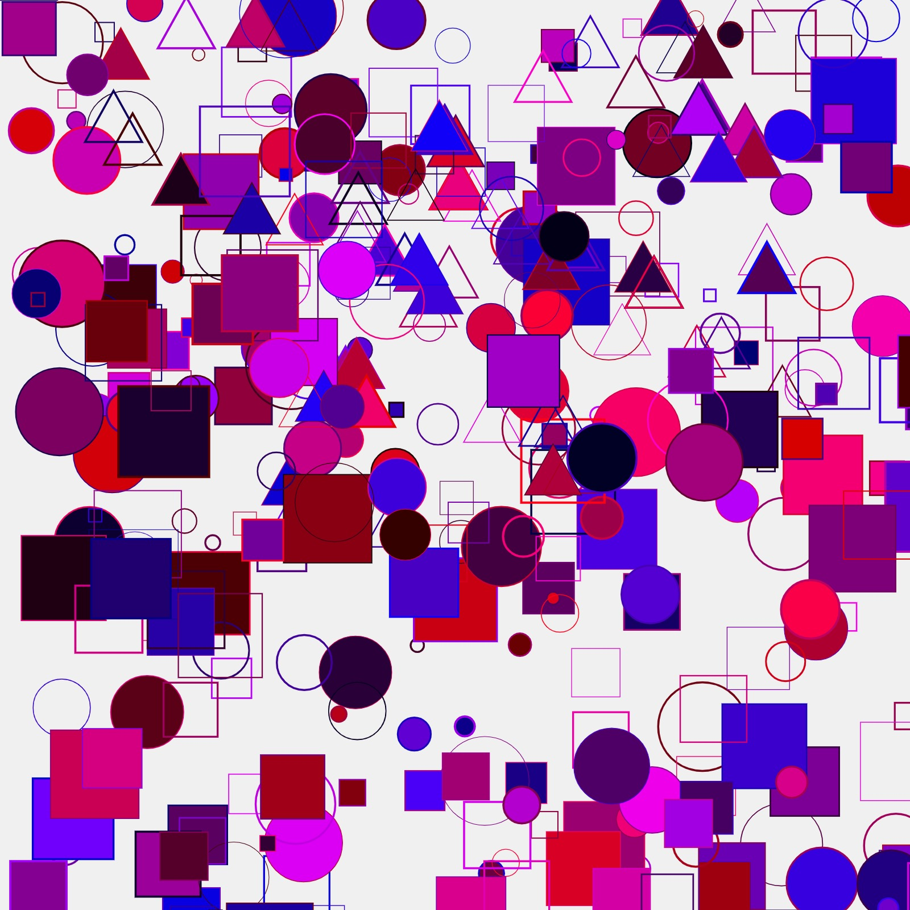
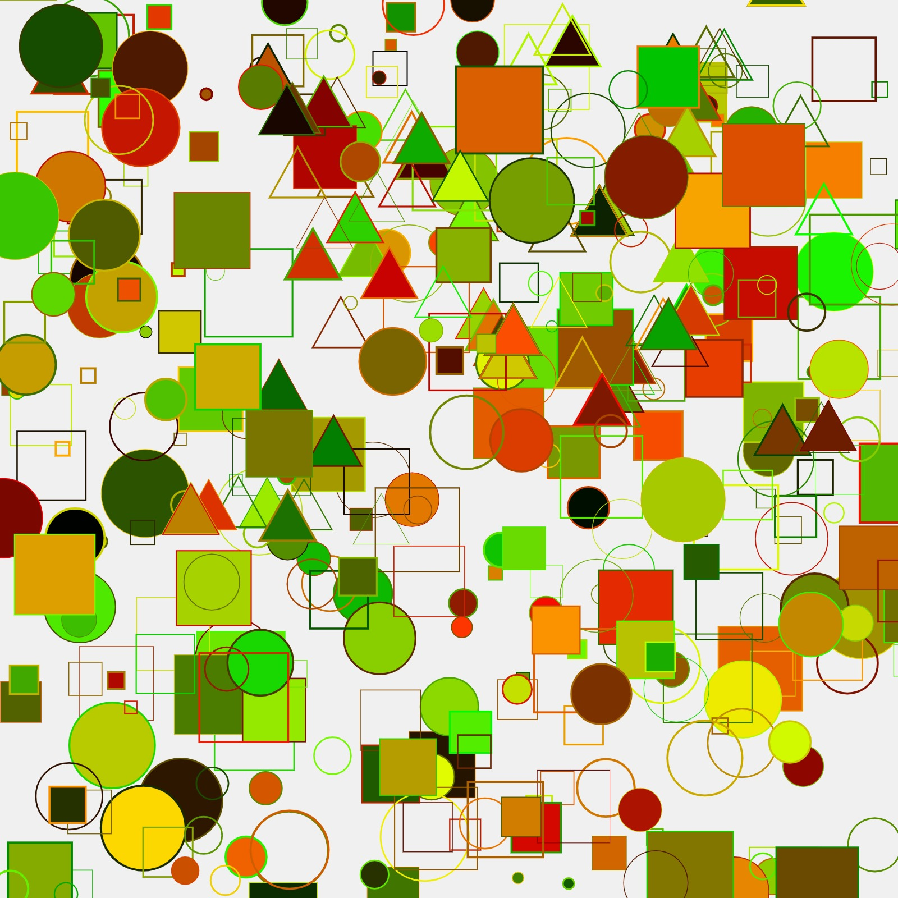

# Week 01 — Drawing with Code

---

### Activities

| Activity | What I Made                                                                                                     |
| -------- | --------------------------------------------------------------------------------------------------------------- |
| `1a`     | Duck plush keychain recreated in p5.js using ellipses, quads, triangles and rects                               |
| `1b`     | A generative composition of random circles, squares and triangles, as a study of Georg Nees' early computer art |

---

### This Week

This week was mostly about getting comfortable with p5.js's basic shape functions — `ellipse()`, `quad()`, `triangle()`, `rect()` — and realizing how much a drawing's final look depends on the _order_ you call `fill()`, `stroke()` and `noStroke()` in, not just which shapes you draw. For 1a I rebuilt my duck plush keychain from scratch, which was a good exercise in breaking down a plush creature into flat geometric shapes. For 1b I played around with a spinoff of Georg Nees' generative plotter art and let `random()` drive the whole composition instead of placing every coordinate by hand — a fun contrast after spending so long nudging duck feet into place.

---

### 1a — Simple Creatures (Duck Plush Keychain)



**Draft 1: blocking out the shapes**



Started with just the body, wings and feet with `ellipse()`, `quad()` and `triangle()` first.

**Draft 2: reshaping the body**



Changed his proportions.

**Final: face added**



Added small orange bill `ellipse()` and two eye `ellipse()`s, got the face to actually show up and match my keychain.

### 1b — Learning By Making (Georg Nees)







For this activity I used `random()` to scatter circles and squares across an 800×800 canvas with random fill/stroke colors and random stroke weights, letting them accumulate frame by frame — similar to the accumulation effect in Georg Nees' early plotter pieces. I also tied one triangle's position to `mouseX`/`mouseY` so I could "paint" triangles interactively on top of the randomness, and used `saveCanvas()` inside `keyPressed()` to grab stills while it was running.

### 🎥 Demo Videos

[Watch activity1b-video01 on Google Drive](https://drive.google.com/file/d/13veDdjZoKkSLXlTLSp9y7IPqMa2aWlEO/view?usp=sharing)

[Watch activity1b-video02 on Google Drive](https://drive.google.com/file/d/1aRLNwwou92Yhd4yE8zKe6BmQB8f9bLdE/view?usp=sharing)

---

### 🗂️ More Process Shots of This Week's Activities

[documentation/](documentation/)

---

### 🧩 Something I Found Interesting

The `noStroke()` / `stroke()` ordering bug from 1a was a good lesson in how p5.js style state carries forward:

```js
// Before — invisible mouth
fill(255, 238, 88);
noStroke(); // stroke is now OFF for everything after this
quad(127, 148, 110, 270, 290, 270, 273, 148); // body
strokeWeight(3); // only sets thickness, doesn't re-enable stroke
line(175, 150, 225, 150); // no color → never renders

// After — fixed
stroke(60); // re-enable stroke with a color
strokeWeight(3);
line(175, 150, 225, 150); // mouth line now shows
noStroke(); // reset before the next shape
```

---

### ❓ Questions I'm Sitting With

Right now my duck's proportions are all hardcoded numbers tied to a 400×400 canvas. How would I rewrite it so the shapes scale relative to `width`/`height` instead? I'd also like to figure out a clean way to group the bill + mouth + eyes into a reusable function so I could reuse the "face" on a different creature.

---

### 🔗 References

- My duck plush keychain — the reference photo I drew from
- [p5.js reference: fill(), stroke(), noStroke()](https://p5js.org/reference/)
- Georg Nees' early generative/plotter art, referenced in the Activity 1b brief
