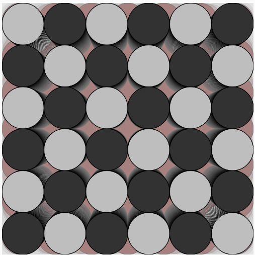
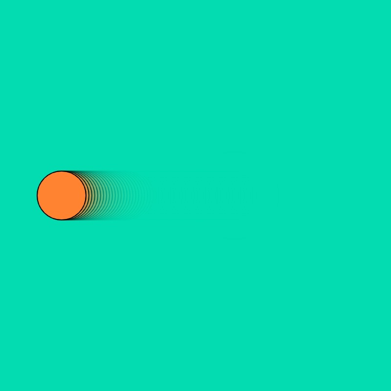
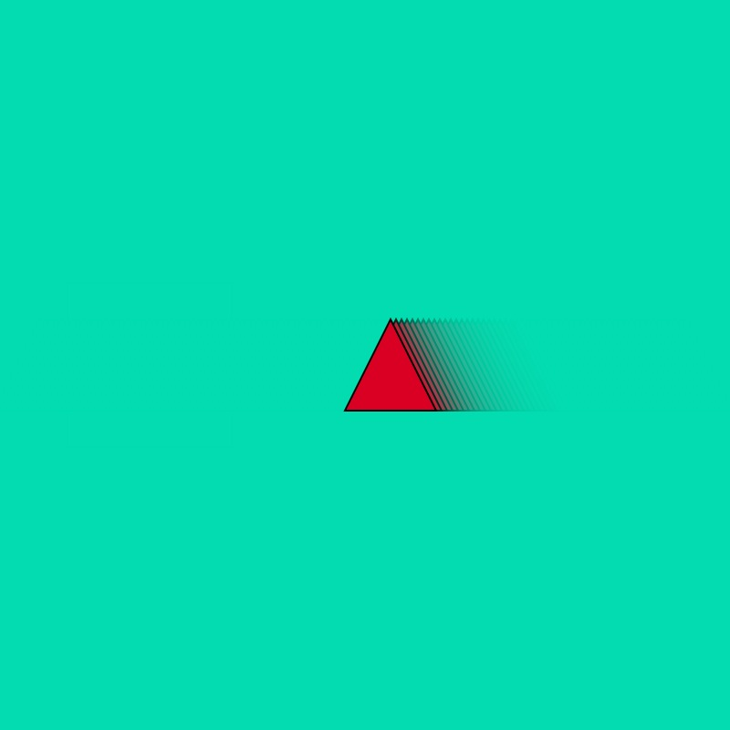
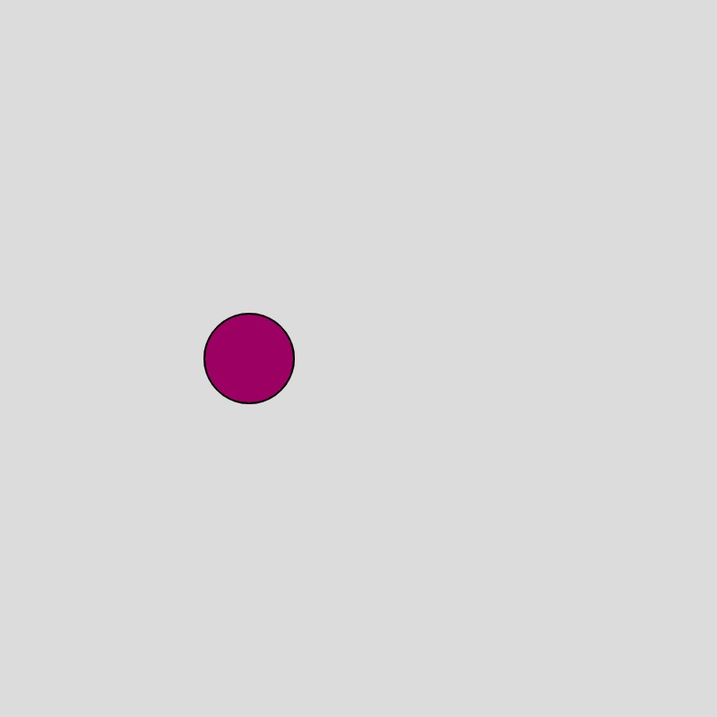
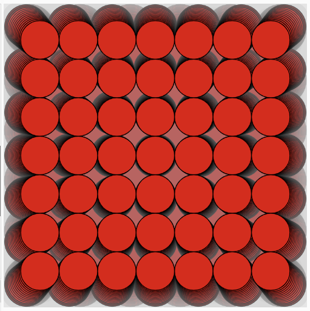
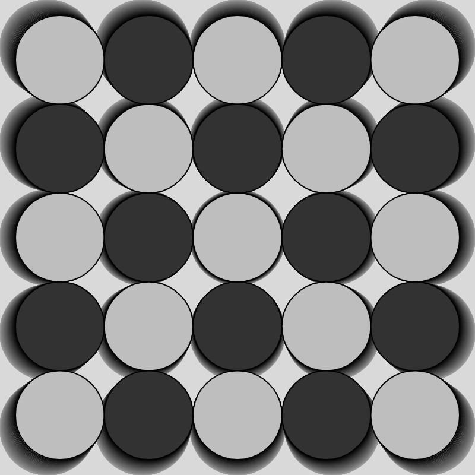

# Week 02 — Control Flows and Interactivity

---

### Activities

| Activity | What I Made                                                                                         |
| -------- | --------------------------------------------------------------------------------------------------- |
| `2a`     | A bouncing shape with three key-switched modes that change its colour, size, speed and shape        |
| `2b`     | A breathing checkerboard of circles built with nested for loops, recoloured by holding down any key |

---

### This Week

For activity 2a I used `switch()` to flip between modes on key presses, and `if/else` inside `draw()` to pick which shape to draw. Most of my time went on the bouncing: pressing a key kept resetting the shape's direction, and when I merged the x and y edge checks with `||` the shape flew off the canvas. Fixing those taught me that each axis needs its own check. Making the motion feel chaotic without looking jittery was also fiddly. Re-rolling a big random speed every frame looked wobbly, so I settled on a small `random(1, 2)` multiplier on x only.

For activity 2b, I used nested `for` loops plus modulo to make a checkerboard, and `sin()` made the grid breathe. `keyReleased()` flag controls the new red colour when a key is held, instead of flickering through a new red every frame.

---

### Output



---

### 2a — Mode Switch







Keys `1`, `2` and `3` use `switch()` to set the background colour, shape size, speed and shape (ellipse, square, triangle). Any other key goes back to the grey default. Inside `draw()`, an `if/else` chain picks which shape to draw from the current mode, and another `if/else` recolours the shape while the mouse is pressed, with `mouseX` blending between blue on the left and red on the right.

The shape bounces off all four edges using separate `dirX` and `dirY` checks. To make it feel chaotic, the x speed is multiplied by `random(1, 2)` every frame. Mode 3 uses a low background alpha (40) to leave a ghost trail, and pressing Enter saves a still with `saveCanvas()`.

Bug I hit: merging the x and y bounce checks with `||` only ever flipped `dirX`, so the shape escaped through the top and bottom. Splitting them into two separate `if/else` blocks fixed it.

### 2b — Pattern Making





Nested `for` loops draw a grid of circles, and `floor(width / d)` works out how many fit. The circle size `d` breathes between 30 and 80 using `sin()` and `map()`, so the grid gets denser and sparser over time. A modulo rule alternates dark and light circles into a checkerboard.

Holding any key switches every circle to a random red, and `keyReleased()` resets a flag so each key press picks one new red instead of flickering. A low-alpha `background(240, 10)` leaves soft trails.

### 🎥 Demo Videos

<!-- Replace each LINK with your Google Drive share link (Anyone with the link, Viewer). -->

[Watch activity2a-video01 on Google Drive](https://drive.google.com/file/d/1hphbHoz2KybhkRJ3S4J-QBF4vpInZ8MG/view?usp=sharing)

[Watch activity2a-video02 on Google Drive](https://drive.google.com/file/d/1lzHhNaiVp-qizFi8h5xjw6VLf3hTj_Kw/view?usp=sharing)

[Watch activity2a-video03 on Google Drive](https://drive.google.com/file/d/1BjH9YCQ3NFWHwCDJHjiSBv79eJaKmwan/view?usp=sharing)

[Watch activity2b-video01 on Google Drive](https://drive.google.com/file/d/1m3yrN53AZhU7s2ZgvFqMWBpfn_ZCRudY/view?usp=sharing)

[Watch activity2a-video03 on Google Drive](https://drive.google.com/file/d/1jcLtL0QFRcA3geQ9w_8_SktVi4vkDtTI/view?usp=sharing)

---

### 🗂️ More Process Shots of This Week's Activities

[documentation/](documentation/)

---

### 🧩 Something I Found Interesting

A held key fires on every frame, so picking a random colour inside `if (keyIsPressed)` would flicker. A flag fixes it: the colour is picked once, then `keyReleased()` re-arms the flag for the next press.

```js
if (keyIsPressed) {
  if (colorChange) {
    altColor = color(random(255), 0, 0);
    colorChange = false;
  }
  fill(altColor);
}

function keyReleased() {
  colorChange = true;
}
```

---

### ❓ Questions I'm Sitting With

- Is there a shorter rule for the checkerboard than `(x % 2 == 0 && y % 2 == 1) || (x % 2 == 1 && y % 2 == 0)`?
- How could the bounce logic avoid repeating the same `if/else` for x and y?

---

### 🔗 References

- [p5.js reference](https://p5js.org/reference/)
