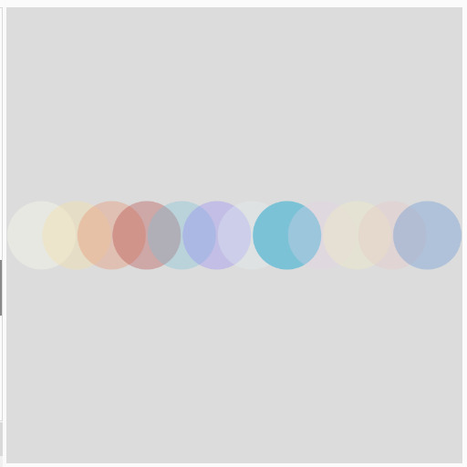
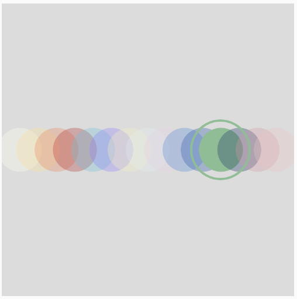
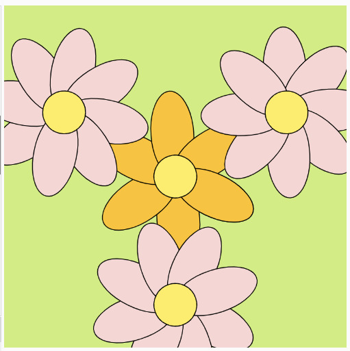
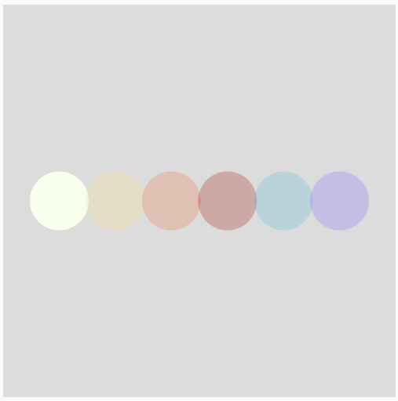
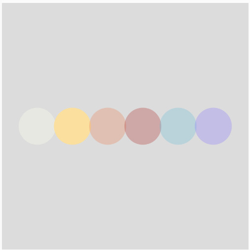
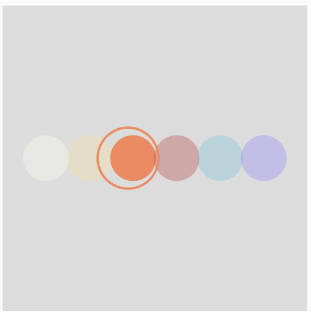
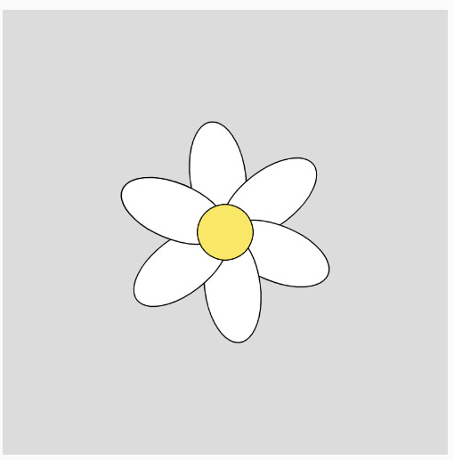
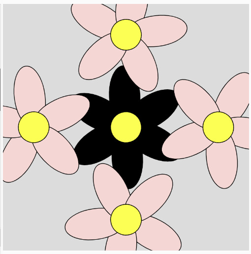

# Week 03 — Arrays, Functions & Transformation

---

### Activities

| Activity | What I Made                                                                                                      |
| -------- | ---------------------------------------------------------------------------------------------------------------- |
| `3a`     | Array Sampler: a row of circles with rings drawn from a colour array that I can grow and shrink with key presses |
| `3b`     | Spinning flowers drawn by one `myFlower()` function, reused to make a ring of flowers                            |

---

### This Week

For 3a, I wanted to make a colourful caterpillar out of a row of circles, with each circle's colour coming from an array. The hardest part was the ring. I wanted it to slide gradually from one circle to the next instead of jumping straight over, and I got that working with `lerp()`. Keys let me add and remove colours, so the caterpillar can grow longer.

For 3b, I started with a spinning white flower that looks like a daisy, one of my favourite flowers, then turned it into a `myFlower()` function so I could reuse it. Getting the flowers spaced evenly in a ring around the centre one was the challenging part.

---

### Output







---

### 3a — Array Sampler







The sketch draws one circle for every colour in the `palette` array. The spacing is worked out from `palette.length`, so the row re-spaces itself as colours are added or removed.

Every 500 ms (timed with `millis()`) the highlight moves to the next colour, while the others are drawn faded.

I added four extra arrays (pinks, greens, blues, yellows). Pressing **P**, **G**, **B** or **Y** uses `push()` to add a random colour from that array, and **R** uses `splice()` to remove the last one.

A ring is drawn around the highlighted circle. It uses `lerp()` to glide to the next circle instead of jumping, and its colour matches the active circle.

I also tried a Dock-style magnification effect, like the one on the macOS Dock. It made my laptop too laggy, so I scrapped it and went for something lighter. [Watch the scrapped version](https://drive.google.com/file/d/1iIXkLeTJOTB2Cl3FLfa84W6i1KiXuEHi/view?usp=sharing)

[Watch the Activity 3a demo](https://drive.google.com/file/d/1qESEtb1EYoLP10rJPwAHapYCIDSiw3v_/view?usp=sharing)

---

### 3b — One Function Wonder





`myFlower(x, y, p, petalColor)` draws a flower with `p` petals. A `for` loop rotates and draws one ellipse per petal, then a circle goes on top as the centre. A global `angle` grows a little every frame, which makes each flower spin.

In `draw()`, I call it once for the middle flower (5 gold petals). Then a second `for` loop places 3 pink flowers (8 petals each) evenly around it. For each one, `push()`, `rotate()`, `translate()` and `pop()` move it out to the same distance from the centre.

The screenshots show how it changed: one white flower first, then four outer flowers around a black centre, and finally three pink flowers around a gold one on a green background.

[Watch the Activity 3b demo](https://drive.google.com/file/d/1FXSwqXIh7iftZI74Vr26CcnUz7271ms2/view?usp=sharing)

---

### 🧩 Something I Found Interesting

To fade the circles that aren't highlighted, I added two characters to the end of a hex colour string. The last two hex digits set the transparency.

```js
fill(color(palette[i] + "55")); // rest of the circles faded
```

---
