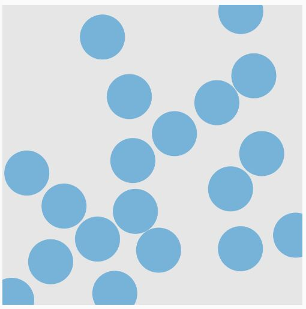
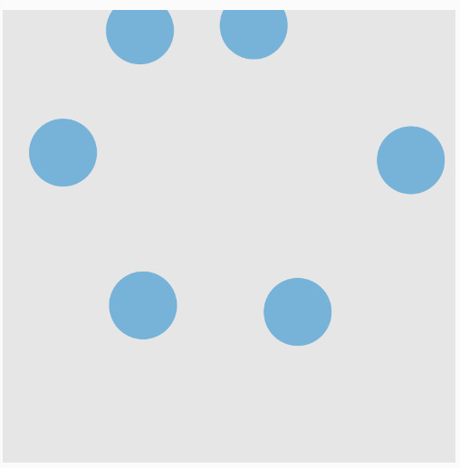
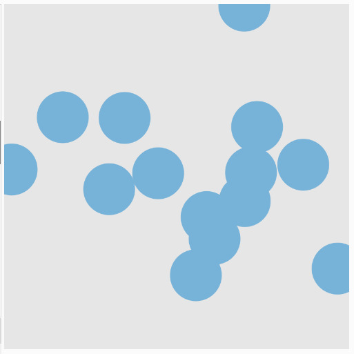

# Week 05 — Object-oriented Programming (Part II)

### Activities

| Activity | What I Made                                                                                                                 |
| -------- | --------------------------------------------------------------------------------------------------------------------------- |
| `5a`     | Colliding Circles: a field of balls, each with a position and velocity vector, that bounce off each other when they collide |

---

### This Week

This week I made Colliding Circles, where each ball stores its position and velocity as vectors instead of separate x and y numbers. I used `dist()` to detect when two balls collide, and when they do, both balls bounce off each other and get pushed apart. Clicking the mouse adds more balls.

### Output





---

### 5a — Colliding Circles

An earlier version, before I pushed overlapping balls apart.



I made a `Ball` class where each ball stores its position and velocity as vectors (`createVector`), plus a radius. Every frame, `move()` adds the velocity vector to the position vector. When a ball goes off one side of the canvas, it wraps around to the opposite side.

Two balls start at different places, and clicking the mouse adds a new ball where I click.

`checkCollision()` compares each ball with the ones after it in the array, so every pair is only checked once. It uses `dist()` to measure how far apart two balls are. If that distance is less than the two radii added together, the balls are colliding.

When two balls collide, both reverse direction. I also push them apart by half of the overlap each, so they don't stay stuck inside each other.

[Watch the Activity 5a demo](https://drive.google.com/file/d/1szgR55OkrTLUJsTr26YIm9RIukRaeiq2/view?usp=sharing)

---

### 🧩 Something I Found Interesting

When two balls overlap, reversing their velocities isn't enough, because they can stay overlapping and keep colliding. So I move each ball away from the other by half of the overlap, using vectors.

```js
let dir = p5.Vector.sub(this.pos, other.pos);
if (dir.mag() === 0) dir = p5.Vector.random2D();
// avoid dividing by 0
dir.normalize();
let overlap = this.r + other.r - d;
this.pos.add(p5.Vector.mult(dir, overlap / 2));
other.pos.sub(p5.Vector.mult(dir, overlap / 2));
```
