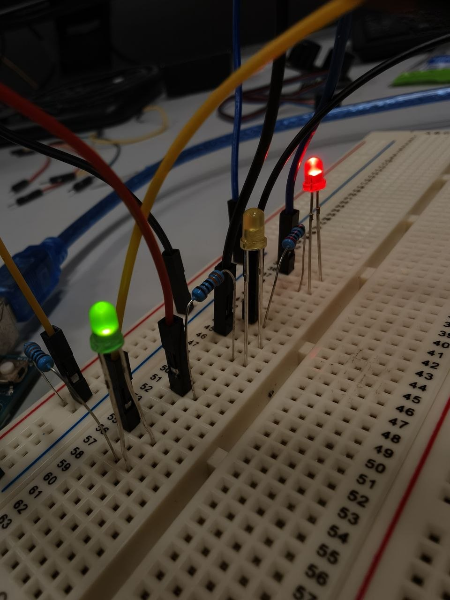
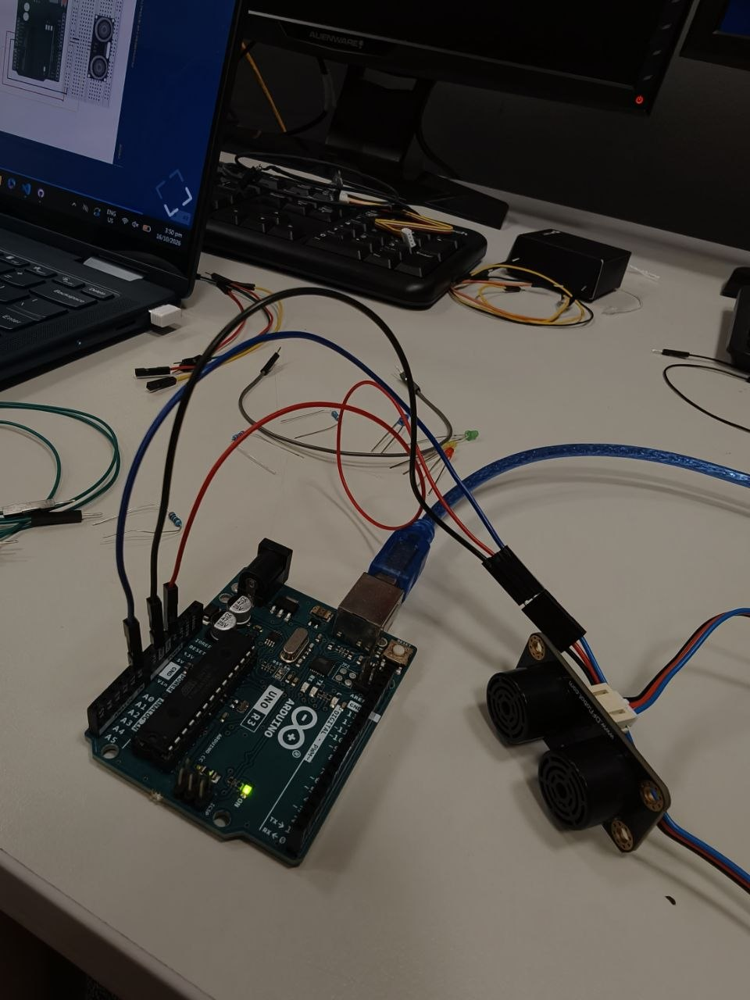
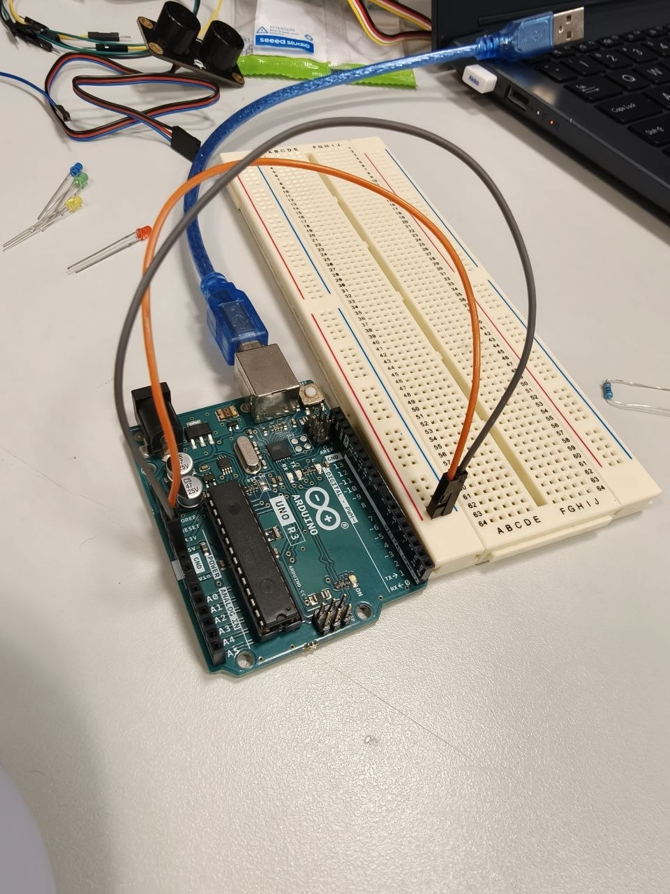
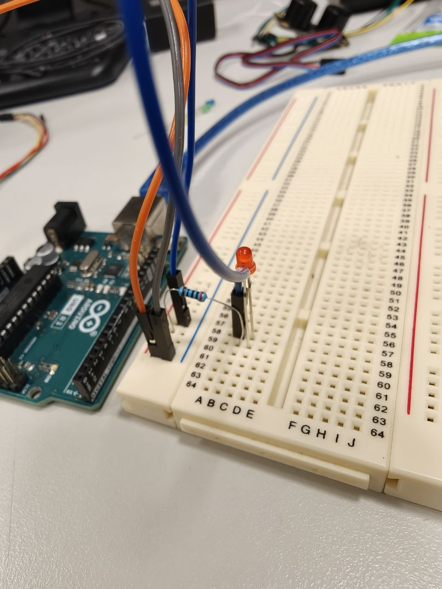
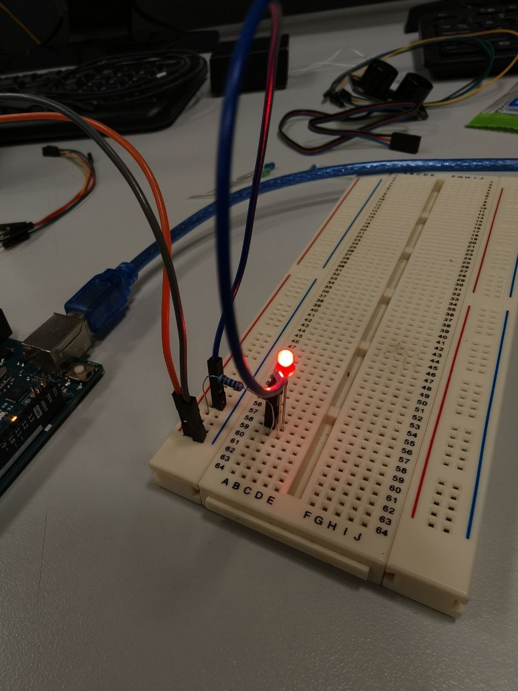
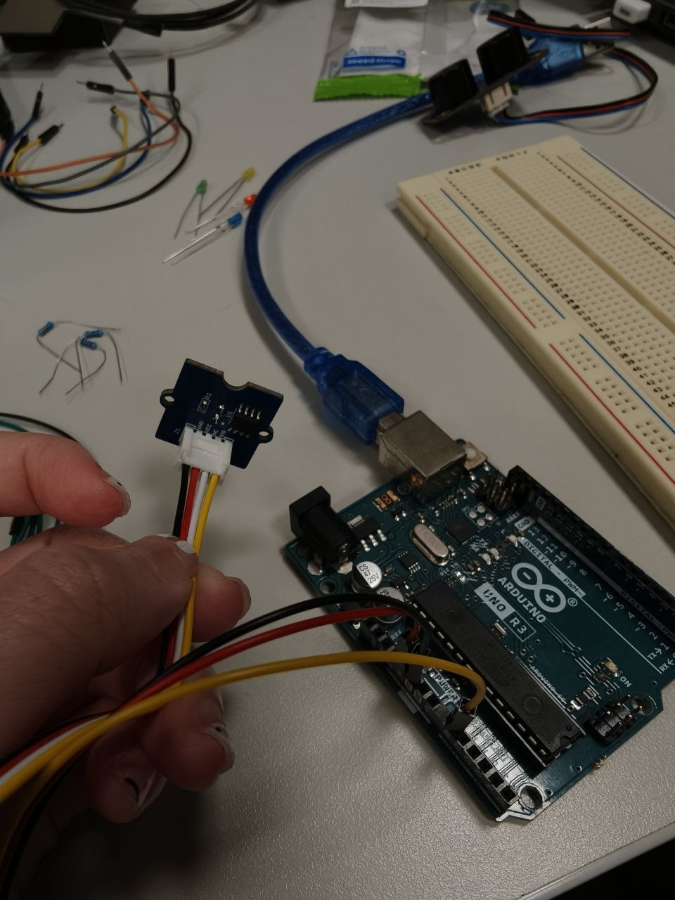
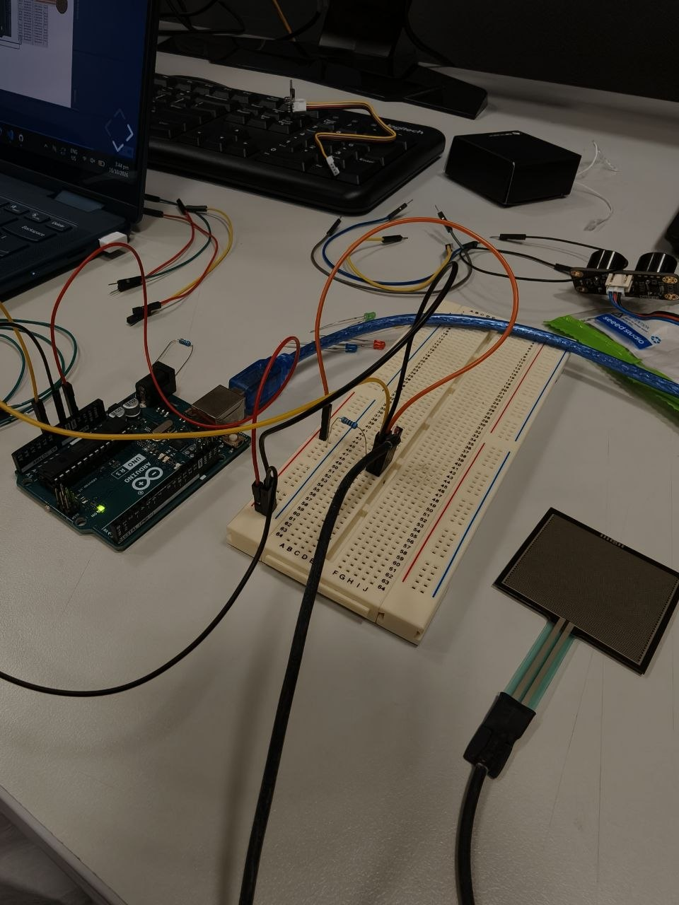

# Week 08 — Arduino Basics

### Activities

| Activity | What I Made                                                                                                                    |
| -------- | ------------------------------------------------------------------------------------------------------------------------------ |
| `8a`     | Combination Challenge: three LEDs doing three different things: one always on, one blinking and one fading                     |
| `8b`     | Sensor Check: reading a phototransistor (light) sensor, a force sensor and an ultrasonic distance sensor in the Serial Monitor |

---

### This Week

I come from an electrical engineering background, so the breadboard, resistors and LEDs were already familiar. What was new this week was controlling them from code, and reading real sensors as numbers.

---

### Output





---

### 8a — Combination Challenge







The challenge was to build a small light system with three LEDs, each controlled in a different way:

- **Always on:** this LED is wired straight to the 5V rail, so it needs no code at all.
- **Blinking:** this LED is on pin `13`, a digital pin. `digitalWrite()` switches it `HIGH` and `LOW`, with a `delay(100)` after each.
- **Fading:** this LED is on pin `9`, a PWM pin (marked with `~`). `analogWrite()` sets its brightness from 0 to 255. Each time through `loop()`, the brightness goes up by `fadeAmount` (5), and when it reaches 0 or 255 the sign flips so the LED fades back the other way.

Each LED has its own resistor, so none of them burn out.

[Watch the Activity 8a demo](https://drive.google.com/drive/folders/1DEKBD133dpihPjKfW5VzCle4zv4wRQzD?usp=sharing)

---

### 8b — Sensor Check

I wired and tested three sensors one at a time, all on analog pin `A0`, and printed their readings to the Serial Monitor. Each sketch uses `Serial.begin(9600)` to start the connection and `Serial.println()` to print a value.

| Sensor                     | What it measures | What a bigger number means |
| -------------------------- | ---------------- | -------------------------- |
| Phototransistor            | Brightness       | More light                 |
| Force sensor               | Pressure         | A harder press             |
| Ultrasonic (URM09, analog) | Distance         | Further away               |

**Phototransistor (light) sensor**



The module has `SIG`, `VCC` and `GND` pins, plus an `NC` pin that I left unconnected. `SIG` goes to `A0`, and `analogRead()` gives a number from 0 (dark) to 1023 (bright).

**Force sensor**



One leg of the sensor goes to 5V and the other goes to `A0`, with a 330Ω resistor from `A0` to GND. The code is exactly the same as for the light sensor, because it reads the same pin. The harder I press, the higher the number.

**Ultrasonic sensor**

This is the analog version of the URM09, so it gives out a voltage that is proportional to the distance. `analogRead()` reads that voltage, and I convert it to centimetres with `(reading * 520.0) / 1023.0`, then clamp the result to 2–500 cm. The sketch prints it as `Distance: 12.3 cm`.

[Watch the Activity 8b demos](https://drive.google.com/drive/folders/1DEKBD133dpihPjKfW5VzCle4zv4wRQzD?usp=sharing) (one clip each for the force, phototransistor and ultrasonic sensors)

---

### 🧩 Something I Found Interesting

`delay()` stops the whole program, so my blinking LED and my fading LED are tied together. Each pass through `loop()` takes about 230 ms (100 + 100 + 30), and the fade only moves one step per pass, so the fade speed depends on the blink timing.

```cpp
void loop() {
  digitalWrite(blinkLED, HIGH);
  delay(100);
  digitalWrite(blinkLED, LOW);
  delay(100);

  analogWrite(fadeLED, brightness);
  brightness += fadeAmount;
  // ...
  delay(30);
}
```
