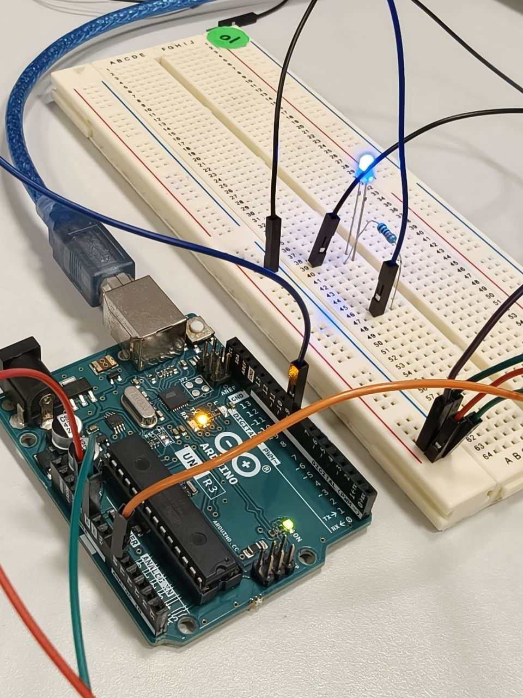

# Week 09 — Sensor to Screen

### Activities

| Activity | What I Made                                  |
| -------- | -------------------------------------------- |
| `9a`     | Mapping ultrasonic, force and light sensors. |

---

### This Week

We connected an ultrasonic distance sensor (the Gravity URM09) to analog pin `A0` and two LEDs to the PWM pins `9` and `10`. The sensor gives back a raw reading from 0 to 1023. The data sheet says it measures from 2 cm to 5 m and that the maximum range to use in the calculation is 520 cm, so I convert the reading to centimetres with `sensorVal * usMaxRange / dataSize`, then clamp it to 2–50 cm so it suits a desk setup.

## Then `map()` turns the distance into a brightness from 0 to 255, and `analogWrite()` sends it to the LED. I flipped the output range for the first LED (`255, 0`), so it gets brighter when my hand is closer. The second LED uses the normal range (`0, 255`), so it gets brighter when my hand moves away. When I move my hand, one LED fades out while the other fades in.

### Output

[Watch the Activity 9a demo](https://drive.google.com/file/d/1n_SieH-zwsuKvFtAxiYJ_N3C3pFEv7nq/view?usp=sharing)

[Watch the Activity 9a demo 2](https://drive.google.com/file/d/1pcm9WD3CncvfgiBAlZNNnjOjrMLQv-Hn/view?usp=sharing)
