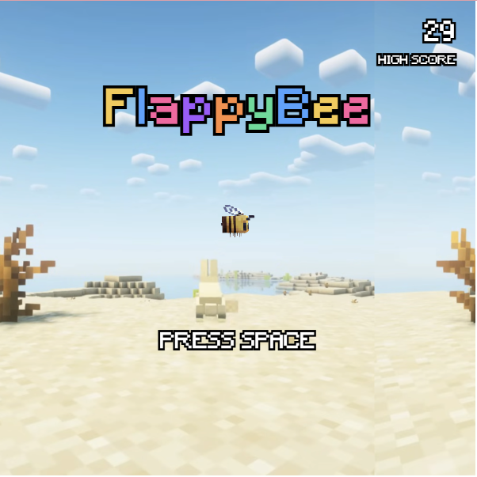

# Mini Project — FlappyBee

### The Project

FlappyBee is a Flappy Bird clone built from the course scaffold (sketch.js, bird.js, pipe.js) with a Minecraft desert theme.
A bee replaces the bird, cactus blocks are the pipes, and a scrolling desert is the background. It has three game states (start, playing, game over), an on-screen score, and a high score that is saved between sessions.

---

### Output

[Watch Online](https://drive.google.com/file/d/1gkzrEkVfic8KceIRBrLx90JXkdoypT7l/view?usp=sharing)

---

### Reflection

We both like Minecraft so we thought of using flying characters in Minecraft to change the Flappy Bird game.

On the logic side, I completed the scaffold's missing pieces. Space flaps the bee, a new pipe spawns every 90 frames, and `Pipe.hits()` checks whether the bee's x-range overlaps a pipe and then whether it is above or below the gap, using the bee's radius. A hit sets `gameState` to `"gameover"`. I added a `"start"` state so the game waits for the player, and restart is on Enter rather than space so mashing the flap key can't skip the score screen.

For scoring, the score goes up by one when a pipe's right edge passes the bee. Each pipe has a `passed` flag, so it only counts once per pipe. The score is drawn at the top centre and reset to 0 in `resetGame()`. The high score is saved with `localStorage`, so it survives a page reload.

For aesthetics, I used my own bee and cactus sprites, a scrolling desert background, a Minecraft font with outlined text, a bobbing multi-colour title on the start screen, background music during play, and a hit sound on collision. [[How do these change how the game feels to play?]]

My main challenges were bugs. `imageMode(CENTER)` from the bee carried over and drew the cactus images off their hitboxes (fixed with `push()`/`pop()`). `loadFont()` needed await, or the game froze on game over. A `localStorage` key mismatch reset my high score on every reload.

---

### What I Changed

- Replaced the circle bird with a bee sprite and the plain pipes with tiled cactus block images.
- Added a scrolling desert background (two copies side by side, wrapping).
- Added a Minecraft font and outlined text for the score and screens.
- Added a start screen with a colour-cycled title, a bobbing bee, and the high score.
- Added a game over screen showing score, high score and an Enter-to-restart prompt, plus `resetGame()`.
- Added a high score saved in `localStorage`.

---

### Code Structure

- `sketch.js` — globals, `setup()`, the `draw()` loop and game states, `drawBackground()`, `drawStartScreen()`, `keyPressed()`, `resetGame()`
- `bird.js` — `Bird` class: movement, gravity, flap, drawing the bee
- `pipe.js` — `Pipe` class: gap placement, tiled cactus drawing, `hits()` collision, `offscreen()`
- `assets/` — bee, cactus and desert images, Minecraft font, music and hit sound
