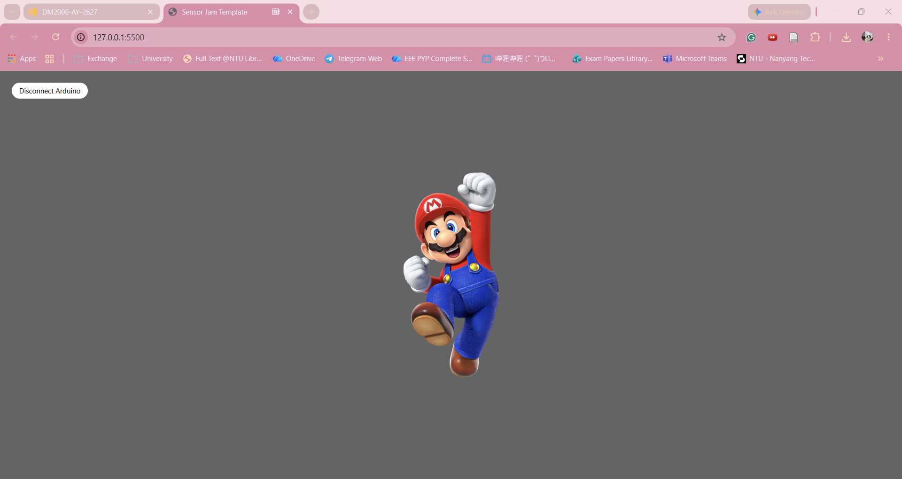
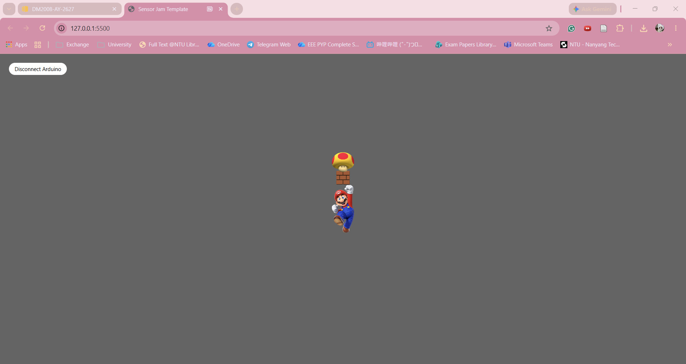
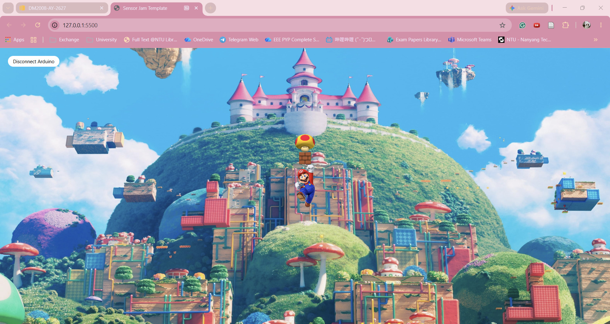
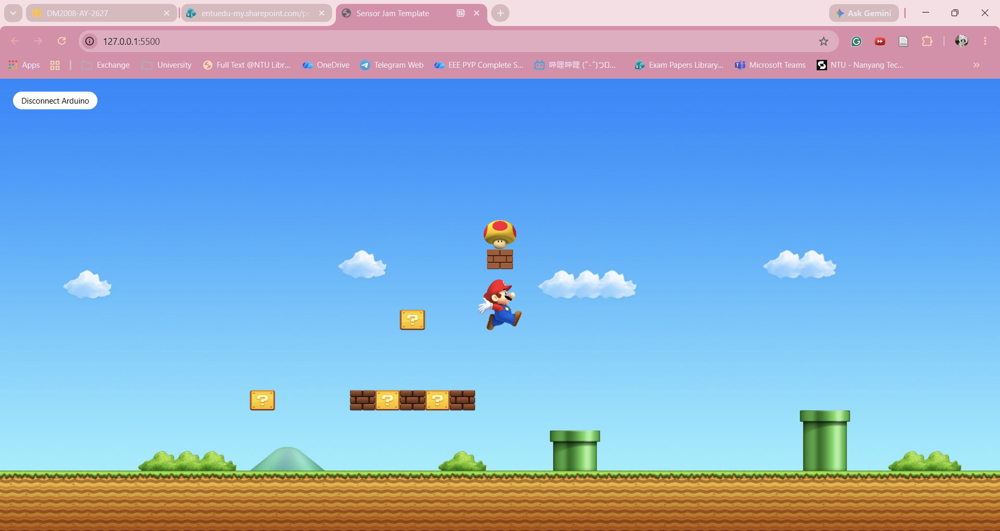

# Sensor Jam — Super Mario

### The Project

We made an interactive Super Mario visual using an Arduino, p5.js and an ultrasonic distance sensor (the Gravity URM09). The sensor measures how far my hand is, and Mario grows or shrinks on screen to match, like he's powering up with a mega mushroom. The further my hand is from the sensor, the bigger Mario gets.

The ultrasonic sensor measures distance in cm and sends the data from Arduino to p5.js through serial communication. The distance values are mapped from 5–100 cm to a Mario sprite width of 50–400 pixels. As distance increases, Mario grows bigger. We used the lerp() function to create smooth transitions between sizes instead of sudden changes.

---

### Output









[Watch the Sensor Jam demo](https://drive.google.com/file/d/1sUZA3Y1_zzggZAMpgqvofkz6e4DAid75/view?usp=sharing)

---

### 🛠️ Hardware

- Arduino Uno and USB cable
- Gravity URM09 analog ultrasonic distance sensor
- Breadboard and jumper wires

The sensor's power goes to 5V, its ground goes to GND, and its signal wire goes to analog pin `A0`.

---

### 🔍 Sensor Mapping

On the Arduino side, I read the sensor, convert it to centimetres, clamp it to 5–100 cm, and send it to p5 as one number per line.

```cpp
distVal = sensorVal * usMaxRange / dataSize;
if (distVal < 5)   distVal = 5;
if (distVal > 100) distVal = 100;
Serial.println(distVal);
```

On the p5 side, I map that distance to Mario's width, then use `lerp()` to move towards it a little each frame so he grows smoothly instead of jumping.

```js
targetSize = map(val, 5, 100, 50, 400);
marioSize = lerp(marioSize, targetSize, 0.1);
```

| Distance | Mario's width |
| -------- | ------------- |
| 5 cm     | 50 px         |
| 100 cm   | 400 px        |

---

### ⚙️ How It Works

1. The Arduino sends one number per line over USB at 9600 baud.
2. In p5, the `p5.webserial` library opens the port when I click **Connect to Arduino**, and `port.readUntil("\n")` reads one line at a time.
3. I convert the text to a number with `float()`, and skip anything that isn't a number, like a half-received line.
4. The scene is drawn in layers: the background image, then the brick, the mega mushroom, and Mario on top.

To run it, close the Arduino Serial Monitor (only one program can use the port), run the folder with Live Server, and open it in Chrome.

---

### ✍️ Reflection

This jam showed me how a physical movement can become something on screen. The ultrasonic sensor only gives me one number, the distance of my hand, but with map() that single number becomes Mario’s size. Moving my hand away makes him grow, and moving it closer makes him shrink, like a mega mushroom power-up.

The part that made the biggest difference was lerp(). when I used the raw reading, Mario jumped around because the sensor reading wasn’t steady. With lerp(), Mario moves towards the target size a little each frame, so the growth looks smooth. It’s the same idea I used in earlier weeks to make movement feel natural, and here it also hides the roughness of a real sensor.

I also learned that both sides need to agree on the numbers. The Arduino clamps the distance to 5–100 cm, and p5 maps that same range to 50–400 px, so the two sketches only work together because of that shared range.

If I kept going, I would make the mushroom and brick move with Mario so they don’t overlap him when he’s big, or add a second sensor to control something else, like the background.

### 🛠️ Hardware

List of physical components you used:

- Arduino Uno
- Gravity URM09 Ultrasonic Distance Measurement Sensor

### 🔍 Sensor Mapping

Distance (5–100 cm) → Mario's width (50–400 px) using map().
