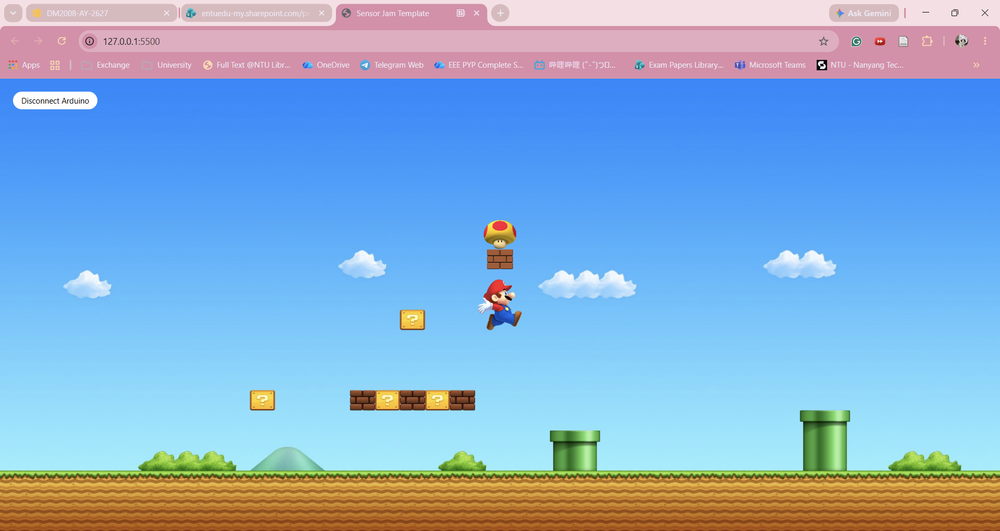

# Sensor Jam — Super Mario

### The Project

We created an interactive Super Mario visual using Arduino, p5.js and Gravity URM09 Ultrasonic Distance Measurement Sensor to measure the distance between sensor and an object. Mario grows and shrinks in size based on the distance detected by the ultrasonic sensor, recreating the effect of Mario powering up with a mega mushroom.

The ultrasonic sensor measures distance in centimetres and sends the data from Arduino to p5.js through serial communication. The distance values are mapped from 5–100 cm to a Mario sprite width of 50–400 pixels. As distance increases, Mario grows bigger. We used the lerp() function to create smooth transitions between sizes instead of sudden changes.

---

### Output

---

### ✍️ Reflection

We wanted to recreate the effect of Mario growing bigger after collecting a mushroom, using real-world distance as the interaction.
We managed to connect the ultrasonic sensor to p5.js and successfully mapped the distance readings to Mario's size.
If we had more time, we would add animations and sound effects, such as Mario jumping to hit the brick and collecting the mushroom before growing bigger.

### 🛠️ Hardware

List of physical components you used:

- Arduino Uno
- Gravity URM09 Ultrasonic Distance Measurement Sensor

### 🔍 Sensor Mapping

Distance (5–100 cm) → Mario's width (50–400 px) using map().

### 🔗 References

- DFRobot Gravity URM09 Ultrasonic Distance Sensor documentation
- Coding Jam starter template provided in class
